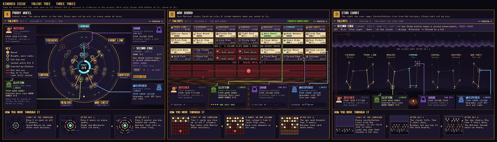
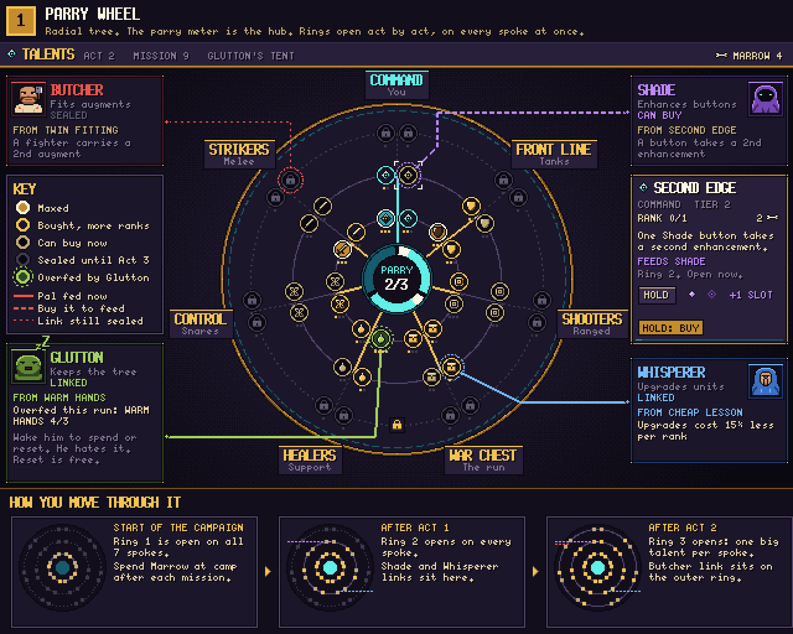
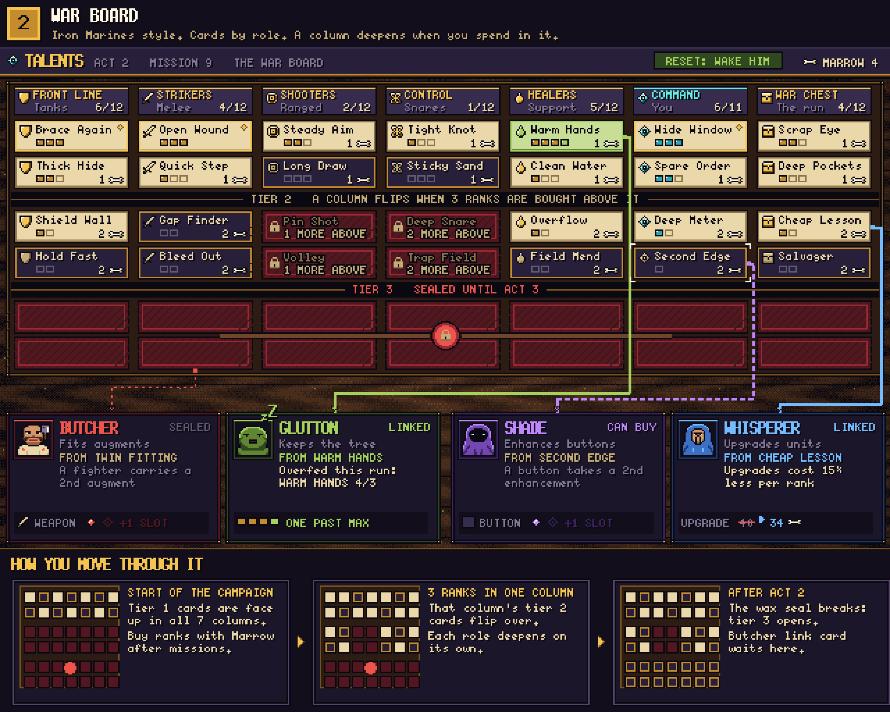
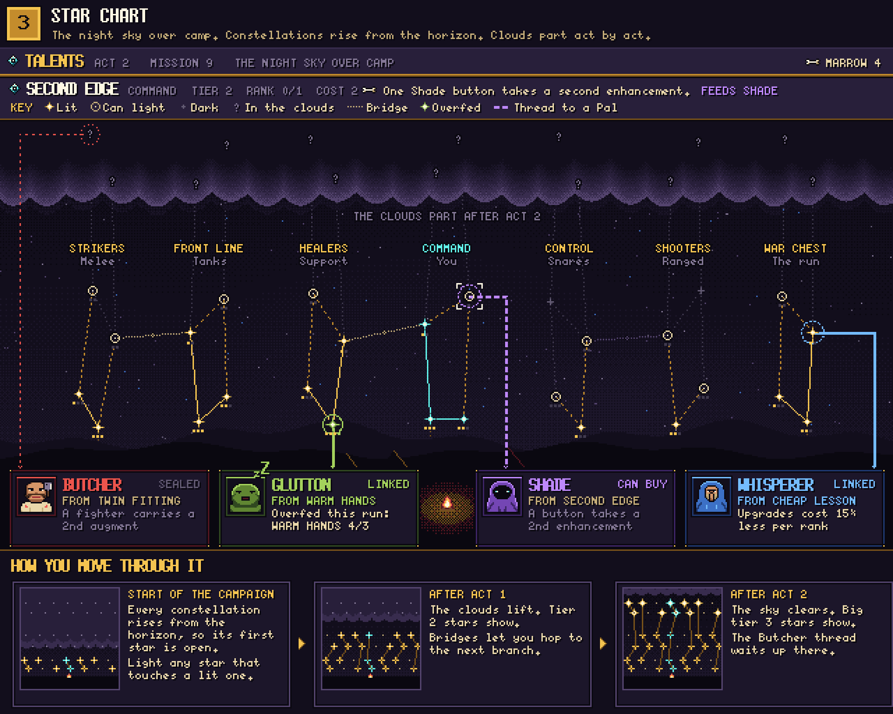

# Talent tree mock: three takes

These are three mocks of the universal talent tree, so you can pick one. They are art and design only. No game code, scenes, saves or builds were changed.

All three use the same 42 talents and the same save: Act 2, mission 9, 4 Marrow to spend. So you are comparing the layout, not the content. Each take has three parts. The top part is the camp screen. The Pal links are drawn on that screen. The strip at the bottom shows how the tree grows over the campaign.

## 1. Parry wheel

The tree is a round drum with the parry meter in the middle. The seven branches are spokes, and each spoke crosses three rings. Ring 1 holds the small talents and ring 3 holds the big ones. Rings open by act, on every spoke at once: ring 1 at the start, ring 2 after Act 1, ring 3 after Act 2. Inside an open ring you can buy any talent in any order with the Marrow you earn after each mission. A row of small dots under each node fills as you buy ranks. The four Pals sit in the corners. Lines run from Twin Fitting (Strikers, ring 3) to the Butcher, from Second Edge (Command, ring 2) to the Shade, from Cheap Lesson (War chest, ring 2) to the Whisperer, and from Warm Hands (Healers) to the Glutton, who has overfed it to 4/3 for this run. A solid line means the Pal gets the bonus now. A dashed line means you can buy it now. A dotted line means it is still sealed.

## 2. War board

This is the Iron Marines style. There are seven columns of cards, one per role, three tiers deep. Tier 1 cards are face up from the start. A column's tier 2 cards flip over once you buy 3 ranks in its tier 1, so each role grows on its own. In this save, Shooters needs 1 more rank and Control needs 2 more. Tier 3 sits under a wax seal that breaks after Act 2. The boxes on each card fill as you buy ranks. The four Pals stand in a row under the board. Cords run down the gaps between the columns, from the same four talents to each Pal's station. Each station has a small picture of what changes: a second augment socket on a weapon, one rank past max, a second socket on a button, and an upgrade cost going from 40 to 34. The Glutton's reset button sits in the top bar.

## 3. Star chart

The tree is the night sky over camp. Each branch is a constellation that rises from the horizon. Low stars are tier 1 and high stars are tier 3. The first star of every constellation is always open. After that you can light any star that touches a lit one, so you pick your own path. Three bridges let you hop into the next branch partway up. Clouds cover the top of the sky and part act by act: only tier 1 shows at the start, tier 2 after Act 1, and tier 3 after Act 2. Lit stars get bigger by tier, and small dots under each star show its ranks. The Pals sit by the camp fire under the sky. Threads of light run down to them from the same four stars. The Butcher's thread starts at a star that is still hidden in the clouds.

## The same in all three

- Twin Fitting feeds the Butcher: a fighter can carry a second augment.
- Second Edge feeds the Shade: one button can take a second enhancement.
- Cheap Lesson feeds the Whisperer: upgrades cost less.
- The Glutton keeps the tree. You spend and reset with him at camp. Once a run he can feed one talent past its max. In this save that is Warm Hands at 4/3.

## Things I made up to fill the mock

- Every talent name, number and cost is a placeholder. Ranks are 3, 2 and 1 by tier, and costs are 1, 2 and 3 Marrow per rank.
- "Marrow" is a placeholder name for the currency you earn after each mission.
- I read "a bigger parry meter" as a Command talent called Deep Meter that adds a 4th segment. That may not match how you want the meter to work.
- The Whisperer discount (15% per rank) is a made up number.

## What I could not check

- The PixelLab tools were not connected in this session. I drew everything with Python (PIL) at 1x and scaled it to 3x with nearest neighbour. No PixelLab credits were spent.
- I have not seen the mocks in Unity or on a real screen at game size. I only looked at the PNG files.
- The text uses X11 bitmap fonts that were on this Linux machine (koi5x8, koi6x13b, koi7x14b, koi9x15b). They are fine for a mock. I did not check their licence for use in the game.
- The script that draws the mocks, `talent-tree-mock/draw_talent_tree_mocks.py`, needs those fonts, so it will not run on Windows as it is.
- I did not check how the images look on the GitHub pull request page.
